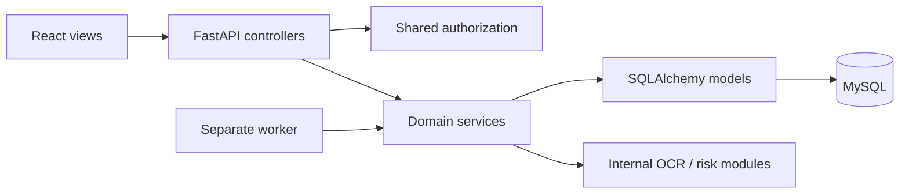

# Architecture and decisions — foundation v1

Decided defaults for implementation, dated 2026-11-04. They are not claims of a completed app or additional faculty approval. The latest team instruction overrides older brainstorming PDFs.

## Stack

| Area | Decision |
|---|---|
| Runtime | Python 3.12; Node 24; MySQL 8.4 LTS, utf8mb4 |
| View | React 19, TypeScript, Vite 7, MUI 7; one shared theme |
| Controller | FastAPI routers + Pydantic request/response schemas |
| Model | SQLAlchemy 2 synchronous ORM + services for domain rules; Alembic migrations; PyMySQL driver |
| Auth | JWT in HttpOnly cookie, Argon2 password hashes; server-tracked sessions/revocation; CSRF protection |
| Jobs | One standalone Python worker using APScheduler 3 as a tick trigger; MySQL is the source of pending work |
| Alerts | In-app polling (30 seconds while visible) + SMTP email; no SMS/push dependency in v1 |
| OCR | Tesseract 5 + pytesseract + Pillow; printed prescriptions only, confirmation/manual entry required |
| Risk | scikit-learn inside the same backend; simple explainable baseline and held-out evaluation |
| Charts / PDF / tests | Recharts / ReportLab / pytest; browser tests introduced with real workflows |

Implemented dependencies are locked in backend/requirements.lock.txt and frontend/package-lock.json. Deferred feature dependencies must get exact tested versions in their introducing PR; they are not silently installed merely because listed here. Runtime major/minor lines are fixed above; record installed patch versions in the team's setup evidence. No claim is made that every future feature library has already been compatibility-tested.

## Request flow

Controllers own one transaction, call permissions before patient data access, and invoke services. Nested service calls use the same session; no independent commits. Services can flush to obtain IDs. After a transaction commits, the worker dispatches durable notifications; an SMTP failure must not roll back a confirmed dose. File storage is private and outside web static directories.

## Directory conventions

`backend/app/controllers/`: thin routers by domain. `schemas/`: Pydantic contracts. `models/`: SQLAlchemy entities. `services/`: business rules/shared interfaces. `core/`: config/security/database wiring. `ml/`: OCR/risk. `worker/`: background execution. `backend/migrations/`: Alembic. `frontend/src/views/<domain>/`: screens, `components/`: shared UI, `lib/`: API/client utilities. Create these domain directories as implemented; empty folders are not evidence of work.

Use `/api/v1` for API routes and `/api/docs` for development Swagger. Same-origin `/api` reverse proxy in deployment; Vite proxy in development. Do not broadly enable credentialed CORS. Binding/hosting/production HTTPS are not implemented in this implementation.

## Authentication design (Sandip implements)

JWT contains `sub`, `sid`, `iat`, `exp`, issuer and audience; verify allowed algorithm and all claims. Default 8-hour session, no refresh flow initially. Store hashed/revocable session identifier; logout and password change revoke sessions. Cookie: HttpOnly, SameSite=Lax, Path=/api, Secure in HTTPS deployments (explicit localhost-only exception for development). No JWT in browser storage. Passwords use Argon2; unique normalized email, generic login errors and rate limiting. Signup never accepts admin privileges.

For all unsafe cookie-authenticated requests require verified same origin and a session-bound CSRF token sent in `X-CSRF-Token`. `/auth/csrf` returns the token; a signed short-lived pre-login cookie supports login/signup protection. Tokens rotate at authentication changes. These endpoints now exist. The token is HMAC-derived from a random session identifier; the session stores its hash. JWT verification and database session expiry/revocation are checked independently. Login/logout/register are implemented; password change/recovery is not yet implemented.

## Permissions and privacy

A user can be a patient in one circle and a caregiver in another. Circle role is membership-specific, not a global user role. Patient owner and one primary caregiver administer the circle; secondary caregiver has explicit scopes. No automatic patient-data access for system admin (admin manages reference data). A read-only doctor share token grants only the prepared summary snapshot, not normal API access.

Patient self-access is verified via patients.user_id. Primary caregiver must have accepted membership and recorded consent; do not infer consent from a matching email. A caregiver-created dependent profile has recorded representation/consent and is inaccessible to other accounts until invited. Revocation applies immediately to reads, writes, polling, downloads, and pending deliveries. Private health data never appears in public health endpoints or email subject lines.

## UI defaults

Patient-first readable pages, clear status text, labeled controls, keyboard focus, large primary actions, loading/empty/error states, and responsive layouts. Browser route families: `/login`, `/patients/:patientId/{circle,prescriptions,doses,alerts,tasks,symptoms,vitals,appointments,insights,privacy}`. UI visibility helps usability but is never authorization. Show the relevant timezone near dose times.

## Technical references

- FastAPI modular routers: https://fastapi.tiangolo.com/tutorial/bigger-applications/
- SQLAlchemy session/transaction ownership: https://docs.sqlalchemy.org/en/20/orm/session_basics.html
- Vite setup: https://vite.dev/guide/
- Source decisions: supplied Claude history, project ideas PDF, named roadmap, group spreadsheet, and revised course outline. Private source documents are intentionally not copied into this repository.
