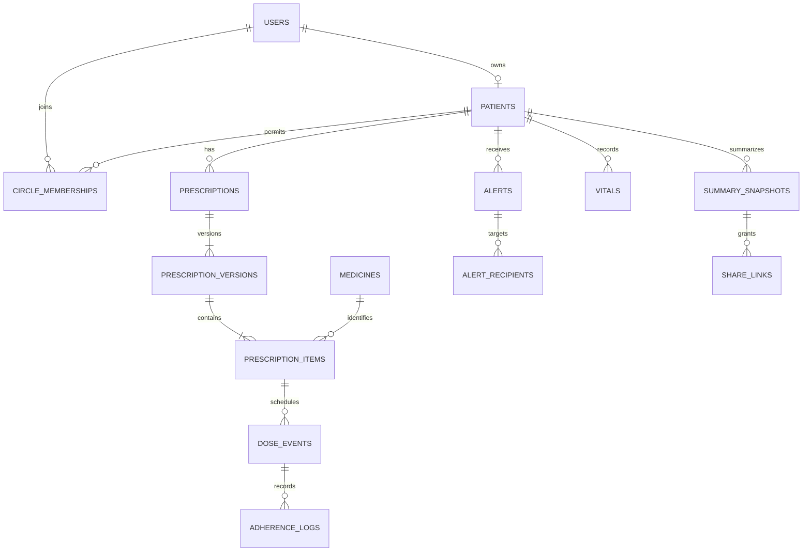

# Shared database blueprint

This is the full-project implementation target. **Migration 0001_sandip implements the identity/circle/alert foundation subset**, with a database-backed auth rate limiter; `0002_tanjila` adds medicines, interaction_rules, prescriptions, prescription_versions, prescription_items, warning_checks, reference_revision and Patient.allergies; other domain entities remain planned. The migration and ORM code are authoritative for the implemented subset. Tanjila coordinates subsequent revisions. All UUID PK/FK columns use CHAR(36); all entities have `id`, `created_at`, `updated_at` unless noted. Use MySQL 8.4/InnoDB/utf8mb4 and explicit foreign keys/indexes. API UUIDs are strings. Persist UTC in DATETIME(6), converting aware inputs to UTC before removing timezone metadata for MySQL; attach UTC on read. Date-only values use DATE; local recurring times use TIME plus an IANA timezone.

Patients now include reported generic-name allergies through 0002_tanjila; birth date, blood group and other clinical details remain planned. Patients now include `consent_basis`. Basic patient responses expose name/timezone/role/scopes only. CC-18 adds acknowledged_by/at and resolved_by/at to alerts, plus alert_preferences (patient_id, user_id, timezone, quiet_start/end). AlertRecipient.read_at remains per user. The scoped public feed is implemented. SMTP leases/retries and SOS remain future work.

`?` means nullable. Quantities use DECIMAL(10,3), not float. DB CHECK constraints and service validation enforce positive quantities, valid statuses and ranges. Status strings use VARCHAR with CHECK, matching shared schemas. Patient-scoped tables contain `patient_id` even when derivable; enforce consistency with composite keys/validation in the same transaction, not browser input.

## Identity and access (Sandip)

| Table | Required domain columns / rules |
|---|---|
| users | email_normalized UNIQUE, password_hash, display_name, is_admin DEFAULT false, timezone, disabled_at? |
| auth_sessions | user_id FK, token_id_hash UNIQUE, csrf_token_hash, expires_at, revoked_at?; never store raw JWT/password |
| patients | user_id? UNIQUE FK users, display_name, timezone, birth_date?, blood_group?, conditions JSON, allergies JSON, consent_recorded_at, consent_recorded_by FK users; dependent consent basis required |
| circle_memberships | patient_id, user_id, role primary/secondary, scopes JSON, accepted_at?, revoked_at?; UNIQUE(patient_id,user_id); one active accepted primary (service lock on patient) |
| circle_invites | patient_id, email_normalized, token_hash UNIQUE, role, scopes JSON, expires_at, accepted_at?, revoked_at?, invited_by; single-use token |
| audit_events | patient_id?, actor_user_id?, action, resource_type, resource_id, occurred_at, request_id; append-only, no raw clinical payloads |

Permission scopes: `medicines:read/write`, `adherence:read/write`, `vitals:read/write`, `symptoms:read/write`, `appointments:read/write`, `tasks:read/write`, `alerts:read/write`, `location:read`, `summary:read/create`, `circle:manage`, `privacy:manage`. Write implies same-domain read. Circle management and privacy management default only to patient/primary. Patient owner has all scopes. Primary scopes are assigned explicitly on acceptance; secondary starts with none until granted.

## Medicines and prescriptions (Tanjila)

| Table | Required domain columns / rules |
|---|---|
| medicines | generic_name, brand_name, strength, form, normalized_key UNIQUE, source_name, source_license; strength/form belong to identity |
| interaction_rules | medicine_a_id, medicine_b_id, severity, explanation, source; ordered pair UNIQUE; curated educational reference |
| prescription_documents | patient_id, storage_key UNIQUE, original_name, mime_type, size_bytes, uploaded_by; private file, no public URL |
| prescriptions | patient_id, document_id?, created_by; logical root across revisions |
| prescription_versions | prescription_id, patient_id, version_number, status draft/confirmed/superseded, effective_from, effective_until?, confirmed_by?, confirmed_at?; UNIQUE(prescription_id,version_number); confirmed versions immutable |
| prescription_items | prescription_version_id, patient_id, medicine_id, quantity_per_dose, unit, start_date, end_date?, schedule_kind fixed_times/as_needed, times_local JSON, timezone, meal_relation none/before_meal/after_meal, instructions?; immutable when confirmed |
| symptoms | patient_id, recorded_by, occurred_at, description, severity mild/moderate/severe, related_item_id?, possible_side_effect bool; association is not diagnosis |

Interpret `1+0+1` only in an editable input adapter: propose morning/evening slots, require explicit local times before confirmation. Do not schedule by parsing this text in the worker. `as_needed` has no automatic scheduled dose events or fixed adherence denominator. Allergy data is patient-scoped; CC-04 checks curated generic/allergen mappings with provenance, never assumes the reference set is complete.

## Dose engine and monitoring (Tasin)

| Table | Required domain columns / rules |
|---|---|
| dose_events | patient_id, prescription_item_id, scheduled_at, quantity, unit, status pending/taken/skipped/missed/cancelled, grace_until, snoozed_until?, snooze_count DEFAULT 0; UNIQUE(prescription_item_id,scheduled_at), INDEX(status,scheduled_at) |
| adherence_logs | patient_id, dose_event_id, actor_user_id?, action taken/skipped/snoozed/missed, occurred_at, recorded_at, idempotency_key, payload_hash; immutable; UNIQUE(patient_id,idempotency_key) |
| medicine_stocks | patient_id, medicine_id, unit, quantity; UNIQUE(patient_id,medicine_id,unit); CHECK quantity >= 0 |
| stock_movements | stock_id, dose_event_id?, type consume/refill/adjustment, quantity_delta, actor_user_id?, reason?, occurred_at, idempotency_key UNIQUE; one consumption per dose |
| checkin_plans | patient_id UNIQUE, local_time, timezone, grace_minutes, enabled |
| checkins | patient_id, local_date, response_at?, status pending/ok/missed; UNIQUE(patient_id,local_date) |
| notification_deliveries | alert_recipient_id?, patient_id, recipient_user_id, channel in_app/email, template_key, source_type, source_id, stage, dedupe_key UNIQUE, due_at, attempts, status pending/sending/sent/failed/suppressed, lease_until?, next_attempt_at?, sent_at?, last_error? |

Snooze is an action, not a terminal dose status. Missed is set by the worker after the grace window; a late taken/skipped response may change the current projection but never erases the missed log. Stock decreases once for a taken event, never for skipped/snoozed/missed. If recorded stock is insufficient, record taken truthfully, leave stock at zero and raise a reconciliation alert; don't prevent medication-history capture. Adjustments require reason and audit.

## Alerts, coordination and privacy (Sandip)

| Table | Required domain columns / rules |
|---|---|
| alerts | patient_id, type, severity info/warning/critical, source_type, source_id, dedupe_key, status open/acknowledged/resolved, created_by?, acknowledged_by?, acknowledged_at?, resolved_by?, resolved_at?; UNIQUE(patient_id,dedupe_key) |
| alert_recipients | alert_id, user_id, read_at?, muted_until?; UNIQUE(alert_id,user_id); membership rechecked on delivery/read |
| member_preferences | patient_id, user_id, timezone, quiet_start?, quiet_end?; UNIQUE(patient_id,user_id) |
| family_tasks | patient_id, title, due_at?, assignee_id?, status open/claimed/done/cancelled, created_by; claiming locks row |
| sos_events | patient_id, triggered_by, location_lat?, location_lon?, location_consent, health_snapshot JSON, emergency_contact?, occurred_at; location omitted if consent denied |
| privacy_requests | patient_id, requested_by, kind export/erasure, status pending/processing/completed/failed, completed_at?; downloads private/expiring |

## Insights and visits (Saif)

| Table | Required domain columns / rules |
|---|---|
| vitals | patient_id, recorded_by, kind bp/sugar/weight/spo2, value, secondary_value?, unit, observed_at; bp requires systolic+diastolic; validate units per kind |
| vital_thresholds | patient_id, kind, lower?, upper?, secondary_lower?, secondary_upper?, trend_rule JSON; UNIQUE(patient_id,kind); explicit seeded demo thresholds, not medical advice |
| appointments | patient_id, created_by, scheduled_at, timezone, clinician_label, status scheduled/completed/cancelled, checklist JSON, post_visit_prompt_at? |
| risk_predictions | patient_id, dose_event_id, model_version, score, predicted_at, inputs_cutoff_at; UNIQUE(dose_event_id,model_version); score in [0,1] |
| summary_snapshots | patient_id, created_by, period_start, period_end, storage_key, generated_at; immutable prepared summary |
| share_links | snapshot_id, token_hash UNIQUE, expires_at, revoked_at?, created_by; no general patient API access |
| share_access_logs | share_link_id, accessed_at, outcome; no raw token |
| digest_runs | patient_id, week_start, status, generated_at?; UNIQUE(patient_id,week_start) |

## Migration and seed policy

One Alembic chain, currently headed by 0002_tanjila. Introduce entities incrementally but respect this shared identity and FK plan. Use RESTRICT for clinical-history deletion except CC-20's future explicit reviewed erasure service. Erasure must revoke shares and remove associated private data with tests; it is not implemented in Sprint 1. Never promise erasure with only a soft-delete flag.

Use explicitly synthetic patients: one patient owner, primary caregiver, restricted secondary caregiver, unrelated patient's caregiver, and reference-data admin. Seed via an explicit command using developer-provided passwords, not a public hardcoded credential. Add fixed schedule events around a time supplied by the test. Seed reference medicine rows only with recorded provenance and permitted licensing.

## Implemented CC-03/04 additions

`reference_revision` has singleton id=1 and an incrementing revision, locking catalogue changes and warning confirmation. `warning_checks` persists patient/actor, canonical proposed items, warning snapshots, state hash, expiry, acknowledgement time and unique confirmed version ID. Patient.allergies is a JSON list of normalized generic names; an empty list means no recorded entries, not a verified absence of allergies.

Prescription roots currently have patient_id and created_by, without an OCR document relation. Version 1 confirmation and immutable items are implemented; revisions/stop/history are not. Versions carry `schedule_status=not_integrated`. See [Tanjila’s handoff](tanjila-sprint-1.md) for integration obligations. The blueprint tables above include future fields; current migrations/models define what is available.

## CC-18 migration

0005_sandip follows 0004_tasin, adds nullable lifecycle fields and foreign keys to alerts, and creates alert_preferences with a unique patient/user pair. Existing alerts and recipients are preserved. No preferences means quiet hours are disabled. The planned member_preferences concept above is implemented for this feature as alert_preferences.

## Tanjila Sprint 2 migration

0006_tanjila follows 0005_sandip. ocr_drafts stores patient/uploader, raw and reviewed text, recognition status/confidence, reviewer/time and edit_revision. Images are not stored. prescription_versions adds previous_version_id, change_reason and ocr_draft_id. warning_checks adds replaces_version_id, change_reason and ocr_draft_id. All added fields on existing tables are nullable; existing records are preserved. Once a draft is attached to a confirmed version its reviewed text is immutable. A stopped version has no items and closes the predecessor interval.
